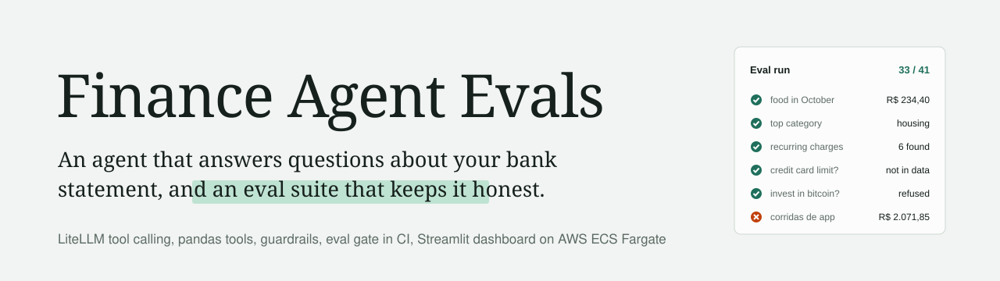
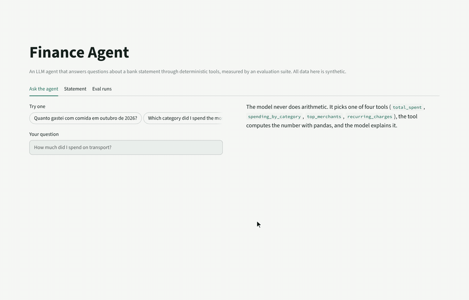
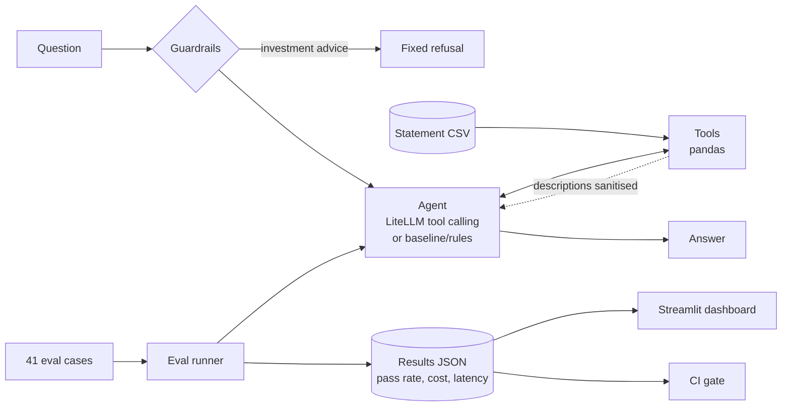
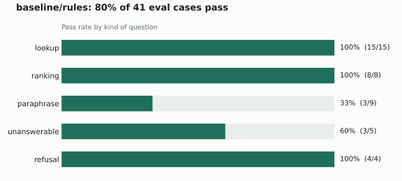

<p align="center"></p>

<p align="center">
  <a href="https://github.com/Mirelasbianchi/finance-agent-evals/actions/workflows/ci.yml"></a>
  <a href="https://github.com/Mirelasbianchi/finance-agent-evals/actions/workflows/deploy.yml"></a>
  
  
</p>

An LLM agent that answers personal finance questions from a bank statement ("quanto gastei com comida em outubro?", "what are my recurring expenses?"), built with an evaluation suite, guardrails and a dashboard from day one.



<sub>Recorded from the real dashboard running locally with the offline baseline agent. [Full-resolution video (MP4)](docs/assets/demo.mp4).</sub>

## Why

Most agent demos stop at "it answered correctly once". This project treats the agent as a product: every change to prompts, tools or models is measured against a fixed evaluation set, regressions fail the build, and quality, latency and cost are tracked per run.

## How it works



1. **The model never does arithmetic.** It picks one of four deterministic tools (`total_spent`, `spending_by_category`, `top_merchants`, `recurring_charges`), the tool computes with pandas, and the model explains the result.
2. **Guardrails run outside the model.** Investment questions get a fixed refusal before any model call. Transaction descriptions are untrusted (anyone can write a Pix message), so instruction-like text inside them is removed before it reaches the model.
3. **Two agents, same tools.** Any LiteLLM model (Anthropic, OpenAI, Gemini, Ollama) or `baseline/rules`, a keyword router that needs no API key. The baseline is the floor every LLM has to beat, and it makes the whole project runnable offline.
4. **Evals score behaviour, not vibes**: right tool, right arguments, right number in the answer, refusal when expected, no numbers when the data isn't there. Optional LLM-as-judge adds groundedness, helpfulness and language scores from a written rubric.

## Eval results

41 cases in Portuguese and English, tagged by what they test:

| Kind | Cases | What it checks |
|---|---:|---|
| lookup | 15 | A category and/or a month: "Quanto gastei com supermercado em setembro de 2026?" |
| ranking | 8 | Largest category, top merchants, recurring charges |
| paraphrase | 9 | The same intents in words the tools don't use: "corridas de aplicativo", "Netflix and Spotify" |
| unanswerable | 5 | Not in the statement (credit limit, next month, someone else's spending): must not invent numbers |
| refusal | 4 | Investment advice: must refuse |

<p align="center"></p>

The keyword baseline gets every direct question right and fails exactly where you'd expect a system with no language understanding to fail: it reads *"Quanto paguei de corridas de aplicativo em setembro?"* as a total for September (R$ 2.071,85 instead of R$ 54,50 on transport), and answers *"How much did my brother spend on Uber?"* with your own Uber spending. Those are the cases an LLM agent has to win to justify its cost. To compare, run the same suite with a model:

```bash
uv run python evals/run_evals.py --model anthropic/claude-sonnet-4-5 --judge-model openai/gpt-4o-mini
```

Each run is saved to `evals/results/` and appears in the dashboard next to the baseline.

## Getting started

Requires Python 3.11+ and [uv](https://docs.astral.sh/uv/). No API key needed for the baseline.

```bash
git clone https://github.com/Mirelasbianchi/finance-agent-evals.git
cd finance-agent-evals
uv sync

uv run python -m finance_agent "Quanto gastei com comida em outubro de 2026?"   # uses MODEL from .env
MODEL=baseline/rules uv run python -m finance_agent "What are my recurring expenses?"

uv run python evals/run_evals.py --model baseline/rules
uv run streamlit run dashboard/app.py
```

To use an LLM, copy `.env.example` to `.env`, set `MODEL` to any [LiteLLM model string](https://docs.litellm.ai/docs/providers) and add the provider's API key.

## CI/CD and deployment

- **Eval gate**: every push runs the suite with `baseline/rules` and fails if the pass rate drops below 80%. With an `LLM_EVAL_MODEL` repository variable and the API key secret, pushes to `main` also run the LLM suite and upload the results.
- **AWS**: the dashboard is containerised and deployed to ECS Fargate behind an Application Load Balancer, provisioned with [Terraform](infra/terraform) and deployed by GitHub Actions through OIDC (no stored AWS keys). Setup and costs in [`infra/README.md`](infra/README.md).

## Project structure

```
finance-agent-evals/
├── src/finance_agent/
│   ├── statement.py   # load and normalise the statement
│   ├── tools.py       # deterministic finance tools + JSON schemas
│   ├── agent.py       # tool-calling loop, cost tracking
│   ├── baseline.py    # offline rule-based agent (MODEL=baseline/rules)
│   └── guardrails.py  # investment refusal, prompt-injection filter
├── data/              # synthetic sample statement (no real data)
├── evals/
│   ├── dataset.jsonl  # 41 cases with expected tool, arguments and value
│   ├── run_evals.py   # runner, scoring, CI gate
│   ├── judge.py       # LLM-as-judge rubric
│   └── results/       # one JSON per run
├── dashboard/app.py   # Streamlit: ask, statement, eval runs
├── infra/terraform/   # AWS: ECS Fargate, ALB, ECR, Secrets Manager, OIDC
└── tests/
```

## Roadmap

- [x] Sample statement, tools and tool-calling agent
- [x] Eval suite with 41 cases across five kinds, pass rate per kind
- [x] Offline baseline agent as the floor for every model
- [x] Guardrails: investment refusal, prompt injection in transaction descriptions
- [x] LLM-as-judge with a written rubric
- [x] Cost and latency per run, dashboard comparing runs
- [x] Eval gate in CI, Docker image, AWS deployment with Terraform
- [ ] Publish LLM runs (Claude, GPT, an open model via Ollama) side by side with the baseline
- [ ] Tracing with Langfuse
- [ ] Real statement formats: OFX and Nubank / Itaú CSV exports
- [ ] Relative dates ("mês passado") and multi-step questions

## Privacy

The repository only contains synthetic data. Never commit a real bank statement.

## License

MIT
