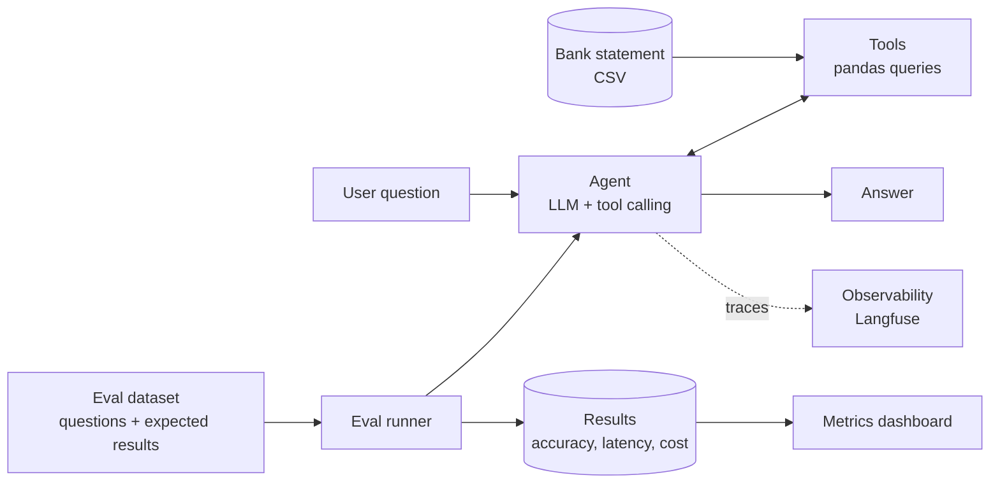

# Finance Agent with Evals

An LLM agent that answers personal finance questions from a bank statement ("how much did I spend on food in October?", "what are my biggest recurring expenses?"), built with an evaluation suite and a metrics dashboard from day one.

> **Status:** work in progress. See the [roadmap](#roadmap).

## Why

Most agent demos stop at "it answered correctly once". This project treats the agent as a product: every change to prompts, tools or models is measured against a fixed evaluation set, and quality, latency and cost are tracked over time.

## Architecture



## How it works

1. **Statement loader** reads a CSV statement into a normalized table (date, description, amount, category).
2. **Tools** are deterministic functions over that table (totals by category or period, top merchants, recurring charges). The LLM never does arithmetic itself; it chooses which tool to call and explains the result.
3. **Agent loop** sends the question and tool schemas to the model, executes tool calls and returns the final answer.
4. **Evals** run the agent over a dataset of questions with known answers and score:
   - tool selection accuracy (did it call the right tool with the right arguments?)
   - answer correctness (does the number in the answer match the expected value?)
   - LLM-as-judge for answer quality on open questions
   - latency and token cost per question
5. **Dashboard** compares eval runs so regressions are visible before they ship.

## Getting started

Requires Python 3.11+ and [uv](https://docs.astral.sh/uv/).

```bash
git clone https://github.com/Mirelasbianchi/finance-agent-evals.git
cd finance-agent-evals
uv sync
cp .env.example .env              # add your model API key

uv run python -m finance_agent "How much did I spend on food in October?"
uv run python evals/run_evals.py   # writes evals/results/<timestamp>.json
uv run streamlit run dashboard/app.py
```

The model is configured with `MODEL` in `.env` and called through [LiteLLM](https://github.com/BerriAI/litellm), so it works with Anthropic, OpenAI, Gemini or local models.

## Project structure

```
finance-agent-evals/
├── src/finance_agent/
│   ├── statement.py   # load and normalize the bank statement
│   ├── tools.py       # deterministic finance tools + JSON schemas
│   └── agent.py       # tool-calling agent loop
├── data/              # synthetic sample statement (no real data)
├── evals/
│   ├── dataset.jsonl  # questions, expected tool calls and answers
│   └── run_evals.py   # eval runner and metrics
├── dashboard/app.py   # Streamlit dashboard over eval results
└── tests/             # unit tests for tools
```

## Roadmap

- [x] Project skeleton, sample statement, first tools and eval runner
- [ ] Expand eval dataset to 50+ questions, including ambiguous and unanswerable ones
- [ ] LLM-as-judge scoring with a written rubric
- [ ] Tracing with Langfuse (latency, tokens and cost per conversation)
- [ ] Dashboard comparing runs across prompts and models
- [ ] Support for real statement formats (OFX, Nubank and Itaú CSV exports)
- [ ] Guardrails: refuse investment advice, handle prompt injection in transaction descriptions
- [ ] Write-up: what the evals revealed and which changes improved the agent

## Privacy

The repository only contains synthetic data. Never commit a real bank statement.

## License

MIT
